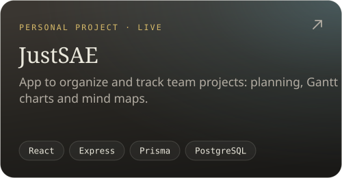
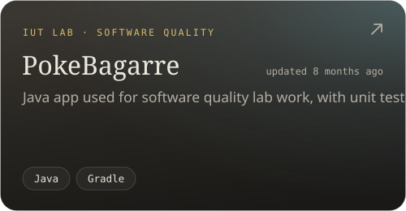

<!-- Généré par outils/generer.py : modifier le script, pas ce fichier. -->

<picture><source media="(prefers-color-scheme: dark)" srcset="https://raw.githubusercontent.com/Justasync/Justasync/main/assets/entete-sombre.svg?v=aeef8cea"><source media="(prefers-color-scheme: light)" srcset="https://raw.githubusercontent.com/Justasync/Justasync/main/assets/entete-clair.svg?v=31e922aa"></picture>

<picture><source media="(prefers-color-scheme: dark)" srcset="https://raw.githubusercontent.com/Justasync/Justasync/main/assets/titre-apropos-sombre.svg?v=eb61b6a7"><source media="(prefers-color-scheme: light)" srcset="https://raw.githubusercontent.com/Justasync/Justasync/main/assets/titre-apropos-clair.svg?v=369408bf"></picture>

<picture><source media="(prefers-color-scheme: dark)" srcset="https://raw.githubusercontent.com/Justasync/Justasync/main/assets/fiche-sombre.svg?v=8c28d0da"><source media="(prefers-color-scheme: light)" srcset="https://raw.githubusercontent.com/Justasync/Justasync/main/assets/fiche-clair.svg?v=c335f175"></picture>

<b>Read my full story</b>

Hi, I'm Christopher Cecilia Urra and I'm from Cuba. There I studied Telecommunications and Electronics Engineering at the Technological University of Havana "José Antonio Echeverría" (CUJAE), and I'm now in the third year of a three-year French Bachelor of Technology (BUT) in Computer Science at the IUT (University Institute of Technology) of Bayonne and the Basque Country. I'm very curious and I love building all kinds of things: JustSAE, an app to organize and track team projects; Paaxio, a platform that helps new artists get discovered; and now an AI agent for home automation. I'm passionate about cybersecurity and I automate everything I can: during my internship at Madaré, a communication agency in Toulouse, I built AuthMIA, which automated internal processes and checked web pages against their mockups. Back in Havana, I also ran my own business, PRINTJAS, offering printing and phone repair services. I love customizing my environment, from my dual-boot PC, Linux and Windows, set up just the way I like it, to my own visual identity. I speak Spanish (my native language), fluent French and English (B2 level, CEFR). Away from the screen, I'm the drummer and a singer in a student band from the CROUS (France's public student services) that plays free concerts. I'm currently looking for a development internship from March 1 to June 18, 2027, as part of my third year of the BUT.

<b>🇫🇷 Version française</b>

Bonjour, je suis Christopher Cecilia Urra et je viens de Cuba. J'y ai étudié l'ingénierie en télécommunications et électronique à l'Université technologique de La Havane "José Antonio Echeverría" (CUJAE), et je suis aujourd'hui en troisième année de BUT Informatique, un diplôme universitaire français en trois ans, à l'IUT (Institut universitaire de technologie) de Bayonne et du Pays basque. Je suis très curieux et j'aime créer toutes sortes de choses : JustSAE, une application pour organiser et suivre des projets en équipe ; Paaxio, une plateforme qui permet aux nouveaux artistes de se faire connaître ; et en ce moment, un agent d'IA pour la domotique. Je suis passionné de cybersécurité et j'automatise tout ce que je peux : pendant mon stage chez Madaré, une agence de communication à Toulouse, j'ai créé AuthMIA, qui automatisait des processus internes et vérifiait les pages par rapport à leurs maquettes. À La Havane, j'ai aussi eu ma propre entreprise, PRINTJAS, de services d'impression et de réparation de téléphones portables. J'adore personnaliser mon environnement, de mon PC en double démarrage (dual boot) Linux et Windows, configuré à mon goût, jusqu'à ma propre identité visuelle. Je parle espagnol (ma langue maternelle), français couramment et anglais (niveau B2 du cadre européen, CECRL). En dehors de l'écran, je suis batteur et chanteur dans un groupe d'étudiants du CROUS (l'organisme public de la vie étudiante en France) qui donne des concerts gratuits. Je recherche actuellement un stage en développement du 1er mars au 18 juin 2027, dans le cadre de ma troisième année de BUT.

<picture><source media="(prefers-color-scheme: dark)" srcset="https://raw.githubusercontent.com/Justasync/Justasync/main/assets/titre-parcours-sombre.svg?v=2514deeb"><source media="(prefers-color-scheme: light)" srcset="https://raw.githubusercontent.com/Justasync/Justasync/main/assets/titre-parcours-clair.svg?v=27744ab9"></picture>

<picture><source media="(prefers-color-scheme: dark)" srcset="https://raw.githubusercontent.com/Justasync/Justasync/main/assets/parcours-sombre.svg?v=8effd98d"><source media="(prefers-color-scheme: light)" srcset="https://raw.githubusercontent.com/Justasync/Justasync/main/assets/parcours-clair.svg?v=5fb5bd6e"></picture>

<picture><source media="(prefers-color-scheme: dark)" srcset="https://raw.githubusercontent.com/Justasync/Justasync/main/assets/titre-projets-sombre.svg?v=88a11990"><source media="(prefers-color-scheme: light)" srcset="https://raw.githubusercontent.com/Justasync/Justasync/main/assets/titre-projets-clair.svg?v=a0e7283c"></picture>

<a href="https://justsae.cloud"><picture><source media="(prefers-color-scheme: dark)" srcset="https://raw.githubusercontent.com/Justasync/Justasync/main/assets/projet-justsae-sombre.svg?v=3b5f0696"><source media="(prefers-color-scheme: light)" srcset="https://raw.githubusercontent.com/Justasync/Justasync/main/assets/projet-justsae-clair.svg?v=66879609"></picture></a>
<a href="https://github.com/Justasync/SAEPaaxio"><picture><source media="(prefers-color-scheme: dark)" srcset="https://raw.githubusercontent.com/Justasync/Justasync/main/assets/projet-paaxio-sombre.svg?v=c04000c3"><source media="(prefers-color-scheme: light)" srcset="https://raw.githubusercontent.com/Justasync/Justasync/main/assets/projet-paaxio-clair.svg?v=00453906"></picture></a>

<picture><source media="(prefers-color-scheme: dark)" srcset="https://raw.githubusercontent.com/Justasync/Justasync/main/assets/projet-authmia-sombre.svg?v=21506eed"><source media="(prefers-color-scheme: light)" srcset="https://raw.githubusercontent.com/Justasync/Justasync/main/assets/projet-authmia-clair.svg?v=e4943dbe"></picture>
<a href="https://github.com/Justasync/PokeBagarre_IUT"><picture><source media="(prefers-color-scheme: dark)" srcset="https://raw.githubusercontent.com/Justasync/Justasync/main/assets/projet-pokebagarre-sombre.svg?v=042b4d43"><source media="(prefers-color-scheme: light)" srcset="https://raw.githubusercontent.com/Justasync/Justasync/main/assets/projet-pokebagarre-clair.svg?v=a0434fe8"></picture></a>

<a href="https://github.com/Justasync/SAE-Qt"><picture><source media="(prefers-color-scheme: dark)" srcset="https://raw.githubusercontent.com/Justasync/Justasync/main/assets/projet-lecteurcd-sombre.svg?v=40d8248c"><source media="(prefers-color-scheme: light)" srcset="https://raw.githubusercontent.com/Justasync/Justasync/main/assets/projet-lecteurcd-clair.svg?v=dac43dda"></picture></a>
<a href="https://www.linkedin.com/in/christopher-cecilia-urra-26a78722a/"><picture><source media="(prefers-color-scheme: dark)" srcset="https://raw.githubusercontent.com/Justasync/Justasync/main/assets/projet-suivant-sombre.svg?v=97443790"><source media="(prefers-color-scheme: light)" srcset="https://raw.githubusercontent.com/Justasync/Justasync/main/assets/projet-suivant-clair.svg?v=91110e83"></picture></a>

<picture><source media="(prefers-color-scheme: dark)" srcset="https://raw.githubusercontent.com/Justasync/Justasync/main/assets/titre-technos-sombre.svg?v=6004e6b7"><source media="(prefers-color-scheme: light)" srcset="https://raw.githubusercontent.com/Justasync/Justasync/main/assets/titre-technos-clair.svg?v=d1d54362"></picture>

<b>WEB</b> 
<picture><source media="(prefers-color-scheme: dark)" srcset="https://img.shields.io/badge/PHP-262420?style=for-the-badge&logo=php&logoColor=E6A23E"><source media="(prefers-color-scheme: light)" srcset="https://img.shields.io/badge/PHP-FFFFFF?style=for-the-badge&logo=php&logoColor=8C6A18"></picture>
<picture><source media="(prefers-color-scheme: dark)" srcset="https://img.shields.io/badge/Laravel-262420?style=for-the-badge&logo=laravel&logoColor=E6A23E"><source media="(prefers-color-scheme: light)" srcset="https://img.shields.io/badge/Laravel-FFFFFF?style=for-the-badge&logo=laravel&logoColor=8C6A18"></picture>
<picture><source media="(prefers-color-scheme: dark)" srcset="https://img.shields.io/badge/Angular-262420?style=for-the-badge&logo=angular&logoColor=E6A23E"><source media="(prefers-color-scheme: light)" srcset="https://img.shields.io/badge/Angular-FFFFFF?style=for-the-badge&logo=angular&logoColor=8C6A18"></picture>
<picture><source media="(prefers-color-scheme: dark)" srcset="https://img.shields.io/badge/React-262420?style=for-the-badge&logo=react&logoColor=E6A23E"><source media="(prefers-color-scheme: light)" srcset="https://img.shields.io/badge/React-FFFFFF?style=for-the-badge&logo=react&logoColor=8C6A18"></picture>
<picture><source media="(prefers-color-scheme: dark)" srcset="https://img.shields.io/badge/JavaScript-262420?style=for-the-badge&logo=javascript&logoColor=E6A23E"><source media="(prefers-color-scheme: light)" srcset="https://img.shields.io/badge/JavaScript-FFFFFF?style=for-the-badge&logo=javascript&logoColor=8C6A18"></picture>
<picture><source media="(prefers-color-scheme: dark)" srcset="https://img.shields.io/badge/HTML-262420?style=for-the-badge&logo=html5&logoColor=E6A23E"><source media="(prefers-color-scheme: light)" srcset="https://img.shields.io/badge/HTML-FFFFFF?style=for-the-badge&logo=html5&logoColor=8C6A18"></picture>
<picture><source media="(prefers-color-scheme: dark)" srcset="https://img.shields.io/badge/CSS-262420?style=for-the-badge&logo=css&logoColor=E6A23E"><source media="(prefers-color-scheme: light)" srcset="https://img.shields.io/badge/CSS-FFFFFF?style=for-the-badge&logo=css&logoColor=8C6A18"></picture>

<b>LANGUAGES</b> 
<picture><source media="(prefers-color-scheme: dark)" srcset="https://img.shields.io/badge/Java-262420?style=for-the-badge&logo=openjdk&logoColor=E6A23E"><source media="(prefers-color-scheme: light)" srcset="https://img.shields.io/badge/Java-FFFFFF?style=for-the-badge&logo=openjdk&logoColor=8C6A18"></picture>
<picture><source media="(prefers-color-scheme: dark)" srcset="https://img.shields.io/badge/Python-262420?style=for-the-badge&logo=python&logoColor=E6A23E"><source media="(prefers-color-scheme: light)" srcset="https://img.shields.io/badge/Python-FFFFFF?style=for-the-badge&logo=python&logoColor=8C6A18"></picture>
<picture><source media="(prefers-color-scheme: dark)" srcset="https://img.shields.io/badge/C%2B%2B-262420?style=for-the-badge&logo=cplusplus&logoColor=E6A23E"><source media="(prefers-color-scheme: light)" srcset="https://img.shields.io/badge/C%2B%2B-FFFFFF?style=for-the-badge&logo=cplusplus&logoColor=8C6A18"></picture>
<picture><source media="(prefers-color-scheme: dark)" srcset="https://img.shields.io/badge/C-262420?style=for-the-badge&logo=c&logoColor=E6A23E"><source media="(prefers-color-scheme: light)" srcset="https://img.shields.io/badge/C-FFFFFF?style=for-the-badge&logo=c&logoColor=8C6A18"></picture>
<picture><source media="(prefers-color-scheme: dark)" srcset="https://img.shields.io/badge/SQL-262420?style=for-the-badge"><source media="(prefers-color-scheme: light)" srcset="https://img.shields.io/badge/SQL-FFFFFF?style=for-the-badge"></picture>

<b>TOOLS &amp; METHODS</b> 
<picture><source media="(prefers-color-scheme: dark)" srcset="https://img.shields.io/badge/Docker-262420?style=for-the-badge&logo=docker&logoColor=E6A23E"><source media="(prefers-color-scheme: light)" srcset="https://img.shields.io/badge/Docker-FFFFFF?style=for-the-badge&logo=docker&logoColor=8C6A18"></picture>
<picture><source media="(prefers-color-scheme: dark)" srcset="https://img.shields.io/badge/BPMN-262420?style=for-the-badge"><source media="(prefers-color-scheme: light)" srcset="https://img.shields.io/badge/BPMN-FFFFFF?style=for-the-badge"></picture>

<picture><source media="(prefers-color-scheme: dark)" srcset="https://raw.githubusercontent.com/Justasync/Justasync/main/assets/pied-sombre.svg?v=326c7810"><source media="(prefers-color-scheme: light)" srcset="https://raw.githubusercontent.com/Justasync/Justasync/main/assets/pied-clair.svg?v=e40f65d1"></picture>

<a href="https://www.linkedin.com/in/christopher-cecilia-urra-26a78722a/"><picture><source media="(prefers-color-scheme: dark)" srcset="https://img.shields.io/badge/LinkedIn-262420?style=for-the-badge&logo=linkedin&logoColor=E6A23E"><source media="(prefers-color-scheme: light)" srcset="https://img.shields.io/badge/LinkedIn-FFFFFF?style=for-the-badge&logo=linkedin&logoColor=8C6A18"></picture></a>
<a href="https://x.com/Justasync01"><picture><source media="(prefers-color-scheme: dark)" srcset="https://img.shields.io/badge/X-262420?style=for-the-badge&logo=x&logoColor=E6A23E"><source media="(prefers-color-scheme: light)" srcset="https://img.shields.io/badge/X-FFFFFF?style=for-the-badge&logo=x&logoColor=8C6A18"></picture></a>
<a href="https://www.instagram.com/justasync/"><picture><source media="(prefers-color-scheme: dark)" srcset="https://img.shields.io/badge/Instagram-262420?style=for-the-badge&logo=instagram&logoColor=E6A23E"><source media="(prefers-color-scheme: light)" srcset="https://img.shields.io/badge/Instagram-FFFFFF?style=for-the-badge&logo=instagram&logoColor=8C6A18"></picture></a>

